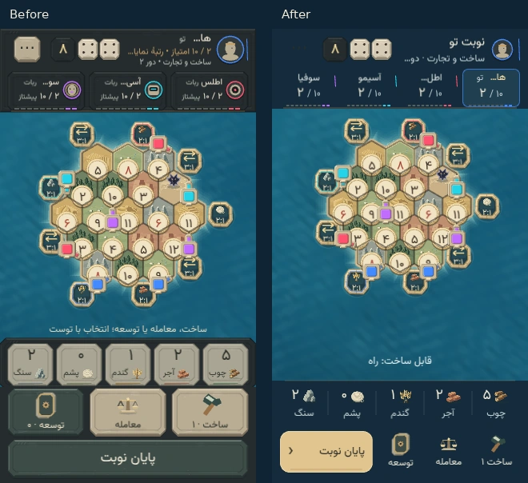
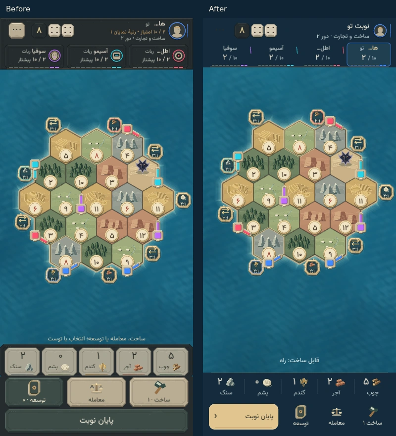
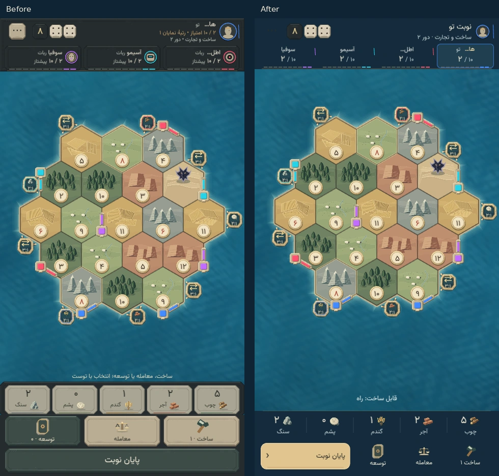
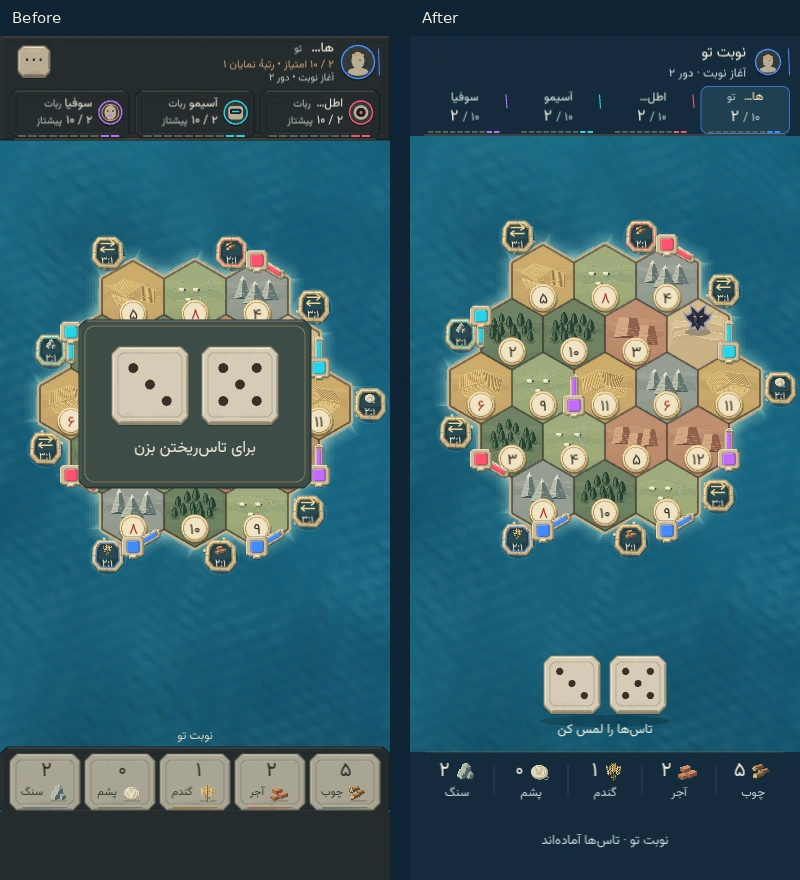

# A lighter, contextual match screen

Implemented in the real game on 21 October 2026. The island, pieces, procedural Persian artwork, core rules, saves and game commands are retained. The screen now has one action workspace, a shared resource hand and a compact public scoreboard.

## Actual-size comparison

These are Chromium screenshots of the real Phaser renderer at CSS-pixel viewport sizes, with the same deterministic saved board and sample human inventory. The left image is the preceding implementation (`7b42073`); the right is this redesign. Automated bot pacing is paused for consistent stills, and reduced motion settles the presentation. The images are review artifacts, not additional runtime assets or a separate game client.

| Viewport  | Previous fixed rows | Current fixed rows | Recovered space |
| --------- | ------------------- | ------------------ | --------------- |
| 320 × 568 | 312 px              | 228 px             | 84 px           |
| 390 × 844 | 316 px              | 228 px             | 88 px           |
| 480 × 900 | 316 px              | 228 px             | 88 px           |

The turn-opening dice also have their own comparison. Their tap target is stationary; only decorative copies of the actual committed result travel into the header.

## Hierarchy and interaction

- **One dock:** three quiet icon/label tools share a 68 px workspace with one 52 px primary action. There is no separate End Turn row. The dock has native enabled/disabled and selected states, a pressed material response, and visible keyboard focus; it performs actions in the current game instead of navigating between pages.
- **Selection:** paid placement shows its cost in the ocean hint. The dock replaces unrelated tools with a legal-location list, clear/cancel and confirmation. The full-size location list is available within the dock, so it no longer consumes a separate board row. Preview and cancellation pay nothing. Required relocation/free roads can clear a preview but cannot cancel the rule obligation. Human discards remain completable during bot turns.
- **Dice:** two standalone ivory faces, 48 or 56 px depending on available geometry, sit below the island with a short label and soft contact shadow. There is no central backing panel. The two actual values remain together in the header after the roll. Pre-roll cards, victory priority and the one-roll guard remain intact; animation never delays legal actions. A storage warning or interface guide uses the pre-roll dock instead of covering the island.
- **Resources:** a 56 px shared lapis hand replaces five raised stone cards. Each passive cell has a resource icon, exact prominent count and Persian name, with thin dividers. Confirmed changes add a brief stationary highlight and exact delta; no interpolated number changes authoritative inventory. Selection styling belongs to actual selectors inside sheets.
- **Players:** the active-turn heading shows a name and phase. Four compact score chips show names, ownership colors, score/10 and progress marks; the active seat has a contrasting rim and a textual turn cue. Tapping any chip opens details. Opponent details omit private VP counts and hand actions; the human hand and private total stay attached to the human seat. Finished games identify the winner.
- **Guidance:** short receipts give way after 2.8 seconds to core-derived build readiness, a one-resource shortage or an explicit waiting message. A pinned build goal retains priority. Mandatory choices keep their instruction. The ocean hint and standalone dice have a short opacity entrance; semantic controls stay in place. History remains available through Pause.
- **Sheets:** Build, Trade and Development remain responsive native-modal bottom sheets with scrolling bodies and fixed actions. Build selection closes the sheet for map interaction. Trade keeps outgoing/incoming resources distinct and closes after final completion. The private card hand retains separate purchase consent, selected effects and timing restrictions.

Frequent controls use flatter deep-lapis surfaces, restrained gold and consistent rounded corners. Limestone is reserved for the consequential action; the board, architecture and focused stone sheets preserve the game's identity. Runtime Persian text, resource shapes and explicit quantities supplement color.

## Geometry and ownership

`matchGeometry.ts` is shared by the actual board composition and semantic dice sizing. It fits the island above a 96/112 px lower-ocean band while retaining the existing 40 px coastal clearance. Width and the hex geometry continue to limit island size; extra height supplies breathing room rather than automatic magnification. The board region, hand and dock keep the same measurements before/after rolling and during placement. Device safe-area padding surrounds the full layout and the bottom material extends behind the home indicator.

`turnMarkup.ts` projects the dock's one primary action and factual guidance from the session/core. `GameHud` preserves the existing commands and rapid-primary guard. The finite receipt timer changes presentation only. `matchChrome.ts` paints the new shared surfaces; `InterfaceScene` owns bounded opacity entrances, and `GameFeedback` consumes each identified confirmed transition once. No visual callback rolls, pays, builds, draws a card or advances a turn.

## Verification

The full Node suite passes **283 tests across 32 files**; TypeScript and scoped ESLint/Prettier also pass. Node regression coverage includes dock priority and confirmation/cancellation, off-turn human discard completion, pre-roll card access, actual resource/location guidance, public opponent details, and island/ocean geometry at 320, 390 and 480 px including safe-inset calculations. The existing rule/session suites continue to cover production, sevens, cards, free roads, title scoring, saves, bots and trade consent.

Requested browser review uses headless Chromium with software WebGL at the three actual viewport sizes. It checks the rendered before/after hierarchy, full-size controls and no horizontal overflow, and exercises real dice → placement/confirmation → bank trade → repeated card purchases → player details. Additional checks cover setup, bot waiting, an off-turn chosen discard, Ahriman relocation, free-road selection, a long private hand, and simulated 47/34 px safe insets. Direct road taps on the board also complete at all three widths. An animated roll check confirms immediate action access, actual 4/4 dice settling into the header, receipt expiry and panel interruption without browser errors. Browser fixtures and controlled rolls exercise the production commands; they do not replace them.

This is browser emulation, not physical iPhone/Android validation or a frame-rate measurement. Native installed-app safe areas, touch feel, hardware audio/haptics and lower-powered-device performance still need device review. Production builds and CI are left to the user under `AGENTS.md`.
