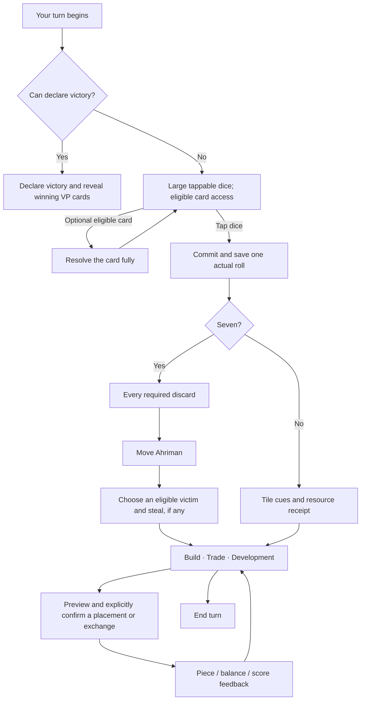

# A more tactile, readable Sunmark

Research and interaction proposal · 20 October 2026

Sunmark now has returning, active players. The next design pass should improve the experience of playing a full match: the rhythm of a turn, the connection between a decision and its result, and the ease of finding useful actions. A cosmetic reskin alone would leave the most important friction in place.

The recommended direction is **a calm board surrounded by tangible game objects**. Dice invite a tap; resource symbols explain a purchase; construction leaves a visible piece behind; a private hand feels like cards. Short labels, exact numbers, and explanations stay available where they matter.

Open the [interactive turn study](design/turn-experience-study.html). It explores the roll, receipt, construction, trade, and card interactions with original procedural illustrations and scripted sample data. It is a separate design study, not a replacement game client or a rules implementation. Its controls and scenario choices are explained [below](#interactive-study).

## What the research establishes

This is a desk study of ten games across action, card, simulation, puzzle, exploration, and gesture-based play, using publisher explanations, developer writing, official support, and publisher-supplied App Store material. The observations below distinguish documented behavior from our proposed adaptation. Publisher screenshots of Brawl Stars, MARVEL SNAP, and Two Dots were also inspected as static images; they are promotional material, not an exhaustive record of their live interfaces. No game was played as part of this research, and no competing animation duration, usability improvement, retention figure, or performance result was measured.

Sources were retrieved on 20 October 2026. Live help pages and store listings can change. These examples supply useful hypotheses; they do not prove that the same interaction will work for Sunmark. Our own players should decide that through repeated use.

| Game and evidence                                                          | What is documented or visible                                                                                                                                                                                                                                                    | Adaptation for Sunmark                                                                                                                                                                                                                                                                     |
| -------------------------------------------------------------------------- | -------------------------------------------------------------------------------------------------------------------------------------------------------------------------------------------------------------------------------------------------------------------------------- | ------------------------------------------------------------------------------------------------------------------------------------------------------------------------------------------------------------------------------------------------------------------------------------------ |
| **Monument Valley** · [ustwo's design rationale][mv]                       | The developers explicitly describe making an experience simple enough to need almost no instruction, with restrained art, sound, text, and animation. They emphasize quality of play time and emotional engagement.                                                              | Let the island and physical action communicate first. Use small, relevant explanations instead of a permanent paragraph of instructions. Keep strategic depth; borrow their approachable presentation rather than their puzzle difficulty model.                                           |
| **Alto's Odyssey** · [developer press kit][alto]                           | One-touch play supports an expressive trick system. The developer describes distinct landscapes, original audio, and a Zen mode without scores, coins, or power-ups.                                                                                                             | A single tap can feel satisfying when press, material, sound, and consequence agree. Keep the sea and landscape atmospheric, with strong motion reserved for actual actions. Sunmark still needs its resource counts and score; removing necessary information would undermine strategy.   |
| **Pokémon GO** · [official catching guide][pokemon]                        | Catching is an encounter with a tangible object: hold and throw a Poké Ball, observe a target ring, then receive an outcome. Item choices remain available within the encounter.                                                                                                 | Give rolling a recognizable object and an immediate response to touch. Keep optional pre-roll card play reachable beside that focused moment. Dice must remain a simple tap: throw strength, aim, swiping, or shaking must never affect the random outcome.                                |
| **Clash Royale** · [Elixir][elixir] and [card-state indicators][evolution] | Cards have a resource dependency; the support guide explains spending Elixir to deploy them. The evolution explanation places progress indicators directly on a card in the hand.                                                                                                | Put cost and readiness on the relevant construction/card, rather than making players infer them from a distant balance. Separate cards that can be played now, cards bought this turn, and hidden VP cards. These are different states, not one generic disabled style.                    |
| **Clash of Clans** · [developer explanation of the UI redesign][coc]       | The redesign groups related work under Build and Battle. Conditional signals follow relevant actions. The developers explicitly say the aim is finding the right controls, not reducing their number for its own sake, and acknowledge relearning costs for established players. | Organize around player intentions: build, trade, use a card. Reveal these at the useful moment without moving their positions every turn. Explain changes once to existing players and preserve familiar terms and escape routes. Avoid adding extra tabs for three construction choices.  |
| **MARVEL SNAP** · [official listing and publisher screenshots][snap]       | The publisher emphasizes quick matches, collectable character cards, and location effects. The inspected promotional screenshots foreground individual cards with distinctive art and visible numerical corners.                                                                 | Give development cards a recognizable silhouette, consistent emblem, and short effect summary. Reserve a small reveal for a privately purchased card. The size and treatment must work at portrait scale. Its cinematic card art is a reference for emphasis, not a template to copy.      |
| **Brawl Stars** · [official listing and publisher screenshots][brawl]      | The inspected match screenshot keeps the arena central, with touch controls at lower left/right and match status along the top. The publisher describes short competitive matches.                                                                                               | Keep frequent decisions in reachable lower controls and status compact above the board. Retain stable positions across phases. Its landscape, two-thumb action layout is not a portrait board-game layout to reproduce directly.                                                           |
| **Two Dots** · [official play guide][dots] and [listing][dots-store]       | The guide states that objectives sit above each puzzle and that unfamiliar mechanics can be inspected through settings. The inspected screenshot uses colored objective symbols and exact counts; the listing explicitly offers a colorblind mode.                               | Use a stable resource vocabulary, small goal/cost symbols, and exact counts. Add shape and text cues so resource availability never depends on color alone. Teach symbols once, keep names available on tap, and let unfamiliar rules be inspected.                                        |
| **Mini Metro** · [developer game page][metro]                              | The map is also the working interface: players draw and redraw lines between stations and decide where limited resources go. Publisher imagery uses a diagram-like map.                                                                                                          | Keep expansion intelligible on the board itself: equal legal targets, a preview, and a visible committed road or building. Explain what a road permits. Do not recommend a route or hide the strategic decision behind a menu.                                                             |
| **Royal Match** · [level guide][royal] and [star reward][royal-stars]      | The level guide places concrete objectives and the move limit in known positions. Completing a level grants a star used for progress outside that puzzle.                                                                                                                        | Connect a completed build visibly to its real reward: the new piece and score change. A restrained “+1 point” belongs to settlement completion; buying a road should not produce a fictitious score reward. Borrow the clarity of cause and reward while keeping Sunmark's turn structure. |

Across these examples, the transferable pattern is coherent action and consequence. An animation is useful when it answers a question: “Did my tap register?”, “Where did that resource come from?”, “What did I spend?”, “What changed on the island?” A decorative transition that repeatedly delays the next decision needs a stronger justification.

## Audit of the current experience

The relevant implementation is `src/game/ui/GameHud.ts`, `humanHud.ts`, `buildFeedback.ts`, `advancedMarkup.ts`, `session.ts`, `GameFeedback.ts`, and `GraphicsFeedback.ts`; motion ownership is documented in [ANIMATION_DESIGN.md](ANIMATION_DESIGN.md).

| Current behavior                                                                                                                                                                                         | Consequence                                                                                    | Proposed change                                                                                                                                                |
| -------------------------------------------------------------------------------------------------------------------------------------------------------------------------------------------------------- | ---------------------------------------------------------------------------------------------- | -------------------------------------------------------------------------------------------------------------------------------------------------------------- |
| A bottom primary button rolls; confirmed dice are small in the header. Build is inspectable before rolling and explains the phase restriction.                                                           | The mandatory action feels like submitting a form; optional navigation can lead to a dead end. | Make large dice the dominant pre-roll object. Put construction planning behind secondary inspection rather than an equally prominent action.                   |
| Core supports non-VP Development Cards before rolling, and an own-turn victory declaration can precede the roll.                                                                                         | Completely hiding cards or forcing a roll would remove legal, meaningful choices.              | Show an eligible pre-roll card affordance when relevant. Victory takes priority over rolling if the player can already declare.                                |
| Build uses a detailed resource/cost/holding/shortage table, supporting text, and a selection control for each option. Resource icons already exist elsewhere, including the hand and placement cost row. | The rules are explicit, but repeated labels make quick comparison expensive.                   | Default to compact icon-led rows with visible quantities and shortages. Retain the detailed explanation as a deliberate inspection.                            |
| The dock presents Build, Trade, and Cards as similar rectangular controls. The build symbol depicts a settlement.                                                                                        | Three distinct activities feel visually interchangeable; “build” can look like “settlement.”   | Use a hammer with a short Build label, trade scales with Trade, and a small original card stack with Development. Keep all three touch targets equally usable. |
| The card panel combines deck composition, timing rules, purchases, card list, selected effect, titles, and score explanations.                                                                           | The first task is finding the action inside a reference page.                                  | Separate a private hand, a purchase area, and compact title progress. Explain one selected card at a time.                                                     |
| Production already has a correct core ledger, finite resource travel, deltas, and reduced-motion support.                                                                                                | We can improve continuity without inventing a second payout system.                            | Coordinate the dice landing, tile cues, resource arrivals, and construction readiness around the same transition.                                              |
| Finished trades now return to the board, while accepted offers still need final consent.                                                                                                                 | This removes an extra dismissal while preserving explicit exchange approval.                   | Keep that behavior; use a brief receipt near resources instead of reopening a result panel.                                                                    |
| Persistent instructions occupy a full context row, even for returning players who know the rules.                                                                                                        | The board competes with prose that often repeats the visible phase.                            | Use a brief status/receipt line. Reserve longer instructions for a required unfamiliar choice or an explanation the player opens.                              |

Some earlier design documents describe an older six-point game with absent cards, ports, trading, and manual setup. Their “current” tables are historical, not the basis for this proposal. [GAME_RULES.md](GAME_RULES.md), [UI_SYSTEM.md](UI_SYSTEM.md), and [DEVELOPMENT_AND_SCORING.md](DEVELOPMENT_AND_SCORING.md) describe the implemented rules.

## The proposed turn

The diagram shows the main path. Card resolution can itself win the game, a build can trigger a public victory, and a seven can require a human discard during a bot's turn. Those conditions override the ordinary presentation. A pre-roll Knight returns to the still-unrolled dice after relocation/theft; a pre-roll Road Building card does so after its legal free placements. Other card effects likewise return to the correct phase. A new turn does not mean automatically rolling.

### 1. Invite the roll

Show two ivory dice, approximately 76–88 CSS pixels per face, in a single generous tap target over a softly quietened area at the center of the board. Keep the island present as context. Use a short runtime Persian label, **برای تاس‌ریختن بزن**, and a clear **نوبت تو** cue. Avoid a separate modal confirmation, an automatic roll, a compulsory swipe, or a repeating bounce.

There are meaningful exceptions to the single-action assumption:

- A playable Development Card must remain one tap away. A small card affordance says **پیش از تاس: ۱ کارت آماده** when an eligible card exists. If none can be played, owned cards remain inspectable through player details; do not advertise a dead-end action beside the dice.
- A player already able to declare victory gets that primary action instead of an invitation to roll. Hidden VP cards remain private until declaration.
- Planning and board inspection remain available without disguising them as executable builds. They must return to the same dice state.
- Opening rolls determine the starter and have different meaning. Reuse the dice object, but say **تعیین آغازکننده**; do not show production. Bots receive compact roll feedback, without repeatedly taking over the center.

The sense of rolling comes from contact, release, the actual revealed values, and a short material sound if enabled. Do not cycle through fabricated pip values. Motion can show edges, backs, or a small tilt before settling on the committed result. Touch timing never changes probabilities.

### 2. Carry the result into the board

After the tap, core computes and stores the result exactly once. The large dice reveal those values, then travel to the measured header slot. That destination should remain visually stable, rather than moving other header controls out of the way. The last result remains readable until replaced; reopening or resuming never rerolls or replays production.

Matching tiles receive a restrained ring. One or a few resource symbols follow the existing production ledger toward their recipient, with quantities such as ×2 for a city. Exact balances update from committed state independently of the animation. A local receipt can say **+۱ چوب · +۱ گندم**; a zero-income roll says **این بار منبعی نگرفتی** without celebratory motion. Blocked terrain never sends a resource.

Do not turn the sequence into a timed cutscene. Once core permits an action, animation completion must not be required to use it. If the player immediately opens Build, finish or cancel obsolete decoration and show correct balances. A seven instead introduces the required discard/move/theft flow, with no production or celebratory sound.

### 3. Reveal useful actions in stable places

After ordinary roll resolution, reveal **ساخت**, **معامله**, and **توسعه** in the lower dock. Keep positions stable even when unaffordable. A construction option that lacks resources is still useful to inspect; disappearance would make the game harder to learn. Use a small, factual readiness count rather than an attention-grabbing notification dot.

End Turn stays quieter than a build confirmation. It should be easy to find, but should not compete with every available action as a bright reward button. Never turn the same rapid second tap on a completed build into an accidental end turn. Required discard, movement, theft, and free roads replace ordinary controls until resolved.

During opponents' turns, keep the human resource hand visible and allow read-only planning. Use compact receipts for their production and construction. Incoming trades remain deliberate interruptions because the human has a decision to make; routine opponent events do not need a modal.

## Construction: read the cost at a glance

Each construction row should have a distinct piece silhouette, its short name, a real point consequence, required resource symbols, quantities, and availability. Keep all three options visible together on a normal phone where text scaling allows. Do not add a carousel that hides the city or requires a swipe to discover it.

For example, a settlement row shows its four required symbols. Each chip pairs **holding / cost** with a check when sufficient or an explicit **۱ کم** when short. The caption **دارایی / هزینه** appears once. Use isolated numeric runs so Persian RTL does not reverse the intended order. If repeated fractions prove slower in player testing, use a large cost digit and a smaller **داری ۰** below it; both are candidates, not a settled visual rule.

- Show every required resource, including sufficient ones. A row with only the missing wool hides what will be spent.
- Surface the most relevant blocker: missing resources, no legal location, road supply exhausted, or wrong phase. Do not imply that enough resources guarantee a legal build.
- A short **جزئیات** action opens the full names, costs, holdings, and rules. Icons carry the scan; labels still carry meaning for new players and assistive technology.
- A hammer plus **ساخت** is the default construction-tool candidate. Test it against a crossed hammer/chisel at actual mobile size. Multiple tiny tools may be less recognizable than one broad silhouette. The three constructible pieces still keep their own thumbnails.
- “Choose location” enters board preview. Show all legal locations equally, retain the destination-list alternative, and pay only on explicit confirmation. Do not glow a strategically preferred route.

An optional player-selected goal connects this panel with trading. Pin **آبادی** and show **۱ پشم کم** beside its symbols. In Trade, show whether the proposed exchange completes that goal and what new shortages the payment creates. Four wood exchanged for wool is useful when at least one required wood remains; it can fail to complete a settlement if it spends the last wood. Derive the before/after explanation from the actual hand and costs. A pinned goal is a memory aid, not an AI instruction to build there next.

## Development: a private hand and a purchase

The deck should look like an object, but its meaning must remain explicit.

The dock uses an original two- or three-card stack with **توسعه** and an owned-card count. Tapping opens a private hand. Put **خرید کارت** in a separate, clearly priced area with remaining deck stock; tapping the dock stack must never spend resources. A drawable deck and cards already owned are different concepts, even if they share a visual language.

Use a warm card border, quiet dark field, and a broad original sun-rosette or architectural seal. A modest stagger and visible card edges are sufficient. Draw the back and effect emblems in code; cache repeated geometry. CATAN can inform the physical metaphor and card proportions, while Sunmark keeps its own motifs, composition, and artwork.

Within the private hand:

- Face-up owned cards have a clear title, one effect emblem, and one short consequence. Tapping selects a card and expands its explanation/action. A long hand scrolls inside a clearly bounded area rather than shrinking every card into an unreadable fan.
- A playable card says **آماده**. One bought this turn says **نوبت بعد** with a turn marker. A used play allowance says **کارت این نوبت بازی شده**. These states need text/silhouette cues as well as color.
- VP cards say **امتیاز مخفی**, contribute to the owner's total, and never have a normal Play button. Opponent card faces and hidden totals never appear in the public projection.
- Purchase confirmation costs one ore/stone, grain/wheat, and wool. A brief private reveal shows the actual drawn card, then places it in the hand with its correct timing status. Repeat purchase remains possible. Skip/faster motion must work; a reveal cannot draw twice.
- Titles belong in a compact score breakdown, with played Knights and continuous road length, rather than paragraphs competing with card play. Explain a transfer when it actually happens.

## Visual and motion language

Preserve the Achaemenid direction, procedural terrain, carved limestone/ivory, basalt foundations, restrained honey-gold accents, and runtime Persian typography. Simplification should come from hierarchy and quieter surfaces: one strong frame per group, fewer nested keylines, and space around the label. It does not require discarding the material language or making every terrain flat.

The board supplies most of the color. Gold means a relevant selection or consequential confirmation. Readiness uses a check plus a short label; shortage uses a broken/marked contour and an explicit count. Avoid making every ready option pulse. Keep resource ordering and resource symbols identical in the hand, construction, trade, cards, and receipts.

The following timings are **initial Sunmark prototypes**, not measured competitor timings or research-proven thresholds. Tune them with returning players after the novelty wears off.

| Event                                | Initial timing                              | Purpose                                                                      |
| ------------------------------------ | ------------------------------------------- | ---------------------------------------------------------------------------- |
| Press/release                        | 60–100 ms                                   | Confirm contact without delaying the command.                                |
| Dice settle on actual values         | 160–220 ms                                  | Give the result a readable physical moment.                                  |
| Dice travel to header                | 240–300 ms, after a brief readable hold     | Explain where the result remains available.                                  |
| Tile cue and grouped resource travel | 400–650 ms, overlapping the dice sequence   | Explain production; show city quantities without flooding the board.         |
| Dock reveal                          | 120–180 ms opacity change                   | Introduce available actions without moving their hit regions.                |
| Construction settle / road trace     | 180–300 ms                                  | Tie the new piece to the selected location.                                  |
| Score change                         | 250–400 ms emphasis                         | Connect the actual point to the build/title; keep the final number readable. |
| Private purchase reveal              | 250–400 ms                                  | Make the card tangible and leave its timing state visible.                   |
| Ordinary trade success               | 150–250 ms emphasis plus a readable receipt | Confirm the balance change and return to the board.                          |

For reduced motion, remove travel/tilt/scale and keep the same result, balances, receipt, and controls. Optional sound should be short and material-specific: a soft ivory contact, a resource tick grouped by event, a stone placement, a modest point cue. Default audio behavior needs player feedback; start the study muted. Avoid per-unit chimes, screen shake, camera zoom, or a reward fanfare for an ordinary turn. Haptics are an enhancement only where available; the PWA must communicate completely without them, especially on iPhone.

[Apple's motion guidance][motion] supports purposeful, brief, optional and cancellable motion; [its feedback guidance][feedback] supports feedback proportional to the event, placed near relevant information, with reasons for unavailable actions. These principles fit this proposal; the precise durations above remain ours to test.

## Portrait layout and accessibility

Keep the reference at 390 × 844 CSS pixels and test down to 320 pixels wide. Safe-area insets reduce usable space and must be applied before layout decisions. A candidate action-phase budget is approximately 104 px header, 26 px passive receipt, 56 px hand, 64 px tool dock, 48 px completion/confirmation row, and 12 px inter-group spacing: **310 px plus safe insets**, leaving about 453 px for the board at 390 × 844 with 47/34 px top/bottom insets. This is a design budget, not a verified replacement for current geometry.

The receipt is passive; History remains a full-size control elsewhere. A visible goal adds height only when pinned. Before rolling, hiding the action dock/completion row can give the board more room, but avoid an abrupt camera refit at every phase change. Reserve a stable island scale across the normal turn, using the freed region for breathing room and the dice object. Fit the island with its coastal clearance; never cover ports with fixed controls.

Maintain the project's 48 × 48 CSS-pixel semantic control minimum. This is a project choice above [WCAG's enhanced 44 × 44 CSS-pixel target guidance][targets], not a conversion from iOS points or Android dp. Small board marks still need equivalent full-size destination-list controls.

Use text and distinct shapes with color. Essential icon/state boundaries target [3:1 non-text contrast][contrast]; normal text targets 4.5:1. Check the rendered material and grayscale result, not just a palette swatch. Keep runtime Persian strings, logical numeric isolation, native modal focus, visible focus, and accessible names such as “آبادی؛ ۱ پشم کم؛ انتخاب محل غیرفعال”. A disabled action needs a nearby readable reason.

No interaction may depend on hovering, long-press discovery, or dragging. Gestures can supplement taps; [WCAG's dragging guidance][drag] explains why a simple-pointer alternative matters. Announce a complete roll/resource result once through the live region, rather than speaking every animation frame; [status-message guidance][status] supports accessible announcements without moving focus.

## Production implementation boundaries

This study proposes presentation changes. Existing rules, card privacy, confirmation, and save behavior remain authoritative.

1. Add a pure presentation projection for the turn surface: active human, phase, eligible card count, declaration eligibility, pending required action, and public result. Do not infer these independently in drawing code.
2. Keep `GameSession` and core commands as the single action path. A dice tap calls the existing roll command once; identified transitions supply the actual values and ledger. Rejected commands never start a success animation.
3. Extend the existing Phaser Graphics interface, shared `drawDie`, resource atlas, semantic controls, and feedback ownership. The study's visible HTML/SVG is an isolated exploration, not a change to the production rendering architecture.
4. Measure the central dice and header destination in the same client coordinate space. A moving feedback clone is decorative and pointer-transparent. Keep actual input regions aligned; do not animate a visible button away from its semantic target.
5. New state, sheet opening, resize, visibility changes, reduced-motion changes, and destruction settle/cancel obsolete effects. Resuming a save displays committed results without replay. Animation callbacks must never pay resources, draw cards, build, or advance a turn.
6. Bound concurrent resource flights, group quantities, cache repeated deck/tool geometry, and reuse text. Profile a representative lower-powered phone before adding effects. Use frame-time measurements (16.7 ms at 60 Hz, 33.3 ms at 30 Hz) as budgets, not a claim that this prototype meets them. Avoid 3D physics, blur-heavy overlays, new render loops, or dependencies for two dice and three cards.
7. Card/free-road/seven resolution must retain complete pause, resume, bot handling, and off-turn human discard behavior. An appealing ordinary roll path cannot bypass mandatory steps or hide a legal pre-roll card.

## Implementation sequence

| Slice                                  | Scope                                                                                                                                              | Must be demonstrated before release                                                                                                                               |
| -------------------------------------- | -------------------------------------------------------------------------------------------------------------------------------------------------- | ----------------------------------------------------------------------------------------------------------------------------------------------------------------- |
| **1 · Dice and turn rhythm**           | Central dice, pre-roll card/declaration exception, stable result destination, coordinated receipts, phase-aware dock.                              | One roll per gesture; correct seven/no-production; eligible pre-roll card discoverable; resume never replays; no delayed-command animation gate; rapid taps safe. |
| **2 · Construction and trade clarity** | Hammer candidate, three compact construction rows, resource legend/inspection, precise shortages, optional goal and before/after trade comparison. | Players can explain cost and blocker; enough resources plus no legal site stays blocked; preview/confirmation preserved; trade outcome returns to board.          |
| **3 · Card objects and private hand**  | Original code-drawn deck, separate buy area, selected-card effects, timing states, private reveal, compact title details.                          | Dock tap never purchases; repeat buying works; new cards remain unavailable; hidden VP stays private; long hands and large text remain usable.                    |
| **4 · Match polish and tuning**        | Audio preferences, repeated-turn pacing, bot receipts, seven/theft/free-road transitions, score/title feedback and compact layout.                 | Full-match comfort, reduced-motion parity, safe-area fit, lower-powered-device frame pacing, interruption/recovery.                                               |

Each slice should be reviewable on its own. No production code needs a speculative redesign of every menu before players can try the dice experience. Preserve existing control names and provide one short, dismissible introduction to moved actions for returning players. Do not add recurring walkthroughs.

## How to judge whether it is better

Use current players as well as people unfamiliar with the rules. Suggested first round: five returning and five new players; counterbalance which interface each group sees first. Treat this as qualitative discovery, not statistical proof. Run the dice sequence repeatedly, then collect feedback after full matches on a later visit so novelty is not mistaken for lasting enjoyment.

| Task / question                                                                        | Observe                                                                                  | Initial decision criterion, to revise with findings                                                          |
| -------------------------------------------------------------------------------------- | ---------------------------------------------------------------------------------------- | ------------------------------------------------------------------------------------------------------------ |
| “It is your turn. Continue.”                                                           | First tap, hesitation, attempts to build before rolling.                                 | At least 8 of 10 find the roll without instruction; record the actual time rather than assuming it improved. |
| Give a player an eligible pre-roll Knight.                                             | Whether they discover the option without first rolling.                                  | Any repeated failure is a blocker for hiding ordinary pre-roll controls.                                     |
| Ask where a gained resource came from.                                                 | Whether they connect the dice, numbered terrain, adjacent building and hand.             | Most can explain the chain after one example; inspect which link is missing.                                 |
| Give exactly one missing resource, then a trade that spends another required resource. | Whether the player correctly predicts both build readiness and the new shortage.         | No misleading “ready” message; correct explanation matters more than speed.                                  |
| Ask to buy, inspect, and play a Development Card.                                      | Confusion between deck stock and owned hand, accidental purchases, timing comprehension. | No accidental spending; players distinguish “ready”, “next turn”, and hidden VP.                             |
| Repeat rolling 15–20 times across play.                                                | Taps to skip, impatience, fatigue, and a short pleasantness rating before/after.         | If the ritual becomes a wait, shorten it or offer a faster feedback setting.                                 |
| Play on a small phone, grayscale, large text, and reduced motion.                      | Cropped controls, lost explanations, unreachable targets, unreadable icons.              | No loss of meaning or completion path; full-size alternatives remain available.                              |
| Pause/reload during a roll, discard, theft, free-road effect, or card reveal.          | Duplicate operations, stale ghosts, lost required choices.                               | Exact saved state resumes; no repeat draw/payout or skipped required step.                                   |

Use an observation sheet or opt-in local diagnostics first; this proposal does not introduce an analytics service. If events are recorded later, measure aggregate action discovery, rejected phase actions, animation skips, and task completion without collecting player names, private hands, or strategic board choices. Enjoyment, comprehension, and control should be assessed together; shorter turns alone are not the goal.

## Interactive study

Files: [HTML](design/turn-experience-study.html), [styles](design/turn-experience-study.css), [script](design/turn-experience-study.js). Run the existing development server and open `/docs/design/turn-experience-study.html`. The study also opens as a local HTML file; its font references the repository's existing Vazirmatn export. It has no external scripts, tracking, downloaded art, or persistence, and does not read or write the real match.

The ordinary scenario demonstrates: tap large dice → actual scripted faces move to the header → resource receipt → open construction → inspect a missing wool → pin settlement → trade four wood for wool → preview/confirm a settlement → see score increase. The card panel explores separate purchase and owned cards, including an eligible pre-roll Knight and a newly bought card. A seven scenario explores choosing discards followed by movement/theft. Restart and reduced-motion controls belong to the study wrapper, not the proposed match UI.

The small island, production, legal locations, opponent responses, and card draws are illustrative fixtures, not a second implementation of the game rules. Production must use existing core queries and commands. The study cannot validate full-match balance, real Phaser performance, mobile browser rendering, or player enjoyment. Browser/device review remains with the user under `AGENTS.md`; syntax, formatting, local references and independent model behavior can be checked in Node without launching a browser.

### Checks performed

The study script passes Node syntax and scoped ESLint checks; changed documents and all three study files pass scoped Prettier checks (explicitly including `docs/design`, which the repository's general formatter ignores). Node smoke checks exercise the sample's production, repeat-roll guard, trade balances, seven/discard gating, no-income roll, card timing, hidden score, Ahriman blocking, and city production. Static checks cover unique HTML IDs, script-to-DOM references, local resources, and absence of storage/network APIs in the study script. Development-server HTTP requests verify the study HTML, stylesheet, script, and font with their expected content types. These checks do not establish visual/device quality; no browser, production build, or CI run was performed.

## Sources

- [ustwo: Monument Valley out now][mv] — developer design rationale, 3 April 2014; read directly.
- [Team Alto: Alto's Odyssey press kit][alto] — one-touch system, atmosphere, audio, and Zen mode; read directly.
- [Pokémon GO: Finding & Catching Wild Pokémon][pokemon] — encounter sequence, item access and throw feedback; read directly.
- [Supercell: Elixir][elixir] — resource dependency; article body read from the public page's embedded content.
- [Supercell: Card Evolution][evolution] — hand-local progress indicators; read directly. Used for interface pattern, not an assertion about today's card balance.
- [Supercell: We've revamped the Clash of Clans User Interface][coc] — grouping, contextual cues, existing-player migration and acknowledged limitations; read directly. Its claim about a week to relearn is not adopted as a measured fact.
- [MARVEL SNAP official App Store listing][snap] — publisher description and two supplied screenshots; inspected as promotional evidence, not live gameplay.
- [Brawl Stars official App Store listing][brawl] — publisher description and supplied match screenshot; inspected as promotional evidence.
- [Two Dots: How do I play?][dots] and [official App Store listing][dots-store] — objective placement, inspectable mechanics, colorblind mode and supplied screenshot; read/inspected directly. Store reviews are not treated as representative research.
- [Dinosaur Polo Club: Mini Metro][metro] — direct map interaction and limited-resource decisions; read directly.
- [Royal Match: How can I play the levels?][royal] and [How can I get stars?][royal-stars] — objective/status placement and concrete completion reward; read directly.
- [Apple Human Interface Guidelines: Motion][motion] and [Feedback][feedback] — public article data read directly; sources for interaction principles, not game-specific timing.
- W3C WCAG 2.2 Understanding: [interaction animation][reduce], [enhanced target size][targets], [non-text contrast][contrast], [dragging alternatives][drag], [status messages][status] — read directly. These are interpretive guidance pages; final accessibility requires implementation review.

[mv]: https://ustwo.com/blog/monument-valley-out-now/
[alto]: https://altosodyssey.com/press/
[pokemon]: https://niantic.helpshift.com/hc/en/6-pokemon-go/faq/102-finding-catching-wild-pokemon/
[elixir]: https://support.supercell.com/clash-royale/en/articles/elixir.html
[evolution]: https://supercell.com/en/games/clashroyale/blog/release-notes/card-evolution-2/
[coc]: https://supercell.com/en/games/clashofclans/blog/news/weve-revamped-the-clash-of-clans-user-interface/
[snap]: https://apps.apple.com/us/app/marvel-snap/id1592081003
[brawl]: https://apps.apple.com/us/app/brawl-stars/id1229016807
[dots]: https://dots.helpshift.com/hc/en/3-two-dots/faq/368-how-do-i-play-two-dots/
[dots-store]: https://apps.apple.com/us/app/two-dots/id880178264
[metro]: https://dinopoloclub.com/games/mini-metro/
[royal]: https://dreamgames.helpshift.com/hc/en/3-royal-match/faq/4-how-can-i-play-the-levels/
[royal-stars]: https://dreamgames.helpshift.com/hc/en/3-royal-match/faq/16-how-can-i-get-stars-1721127793/
[motion]: https://developer.apple.com/design/human-interface-guidelines/motion
[feedback]: https://developer.apple.com/design/human-interface-guidelines/feedback
[reduce]: https://www.w3.org/WAI/WCAG22/Understanding/animation-from-interactions.html
[targets]: https://www.w3.org/WAI/WCAG22/Understanding/target-size-enhanced.html
[contrast]: https://www.w3.org/WAI/WCAG22/Understanding/non-text-contrast.html
[drag]: https://www.w3.org/WAI/WCAG22/Understanding/dragging-movements.html
[status]: https://www.w3.org/WAI/WCAG22/Understanding/status-messages.html
