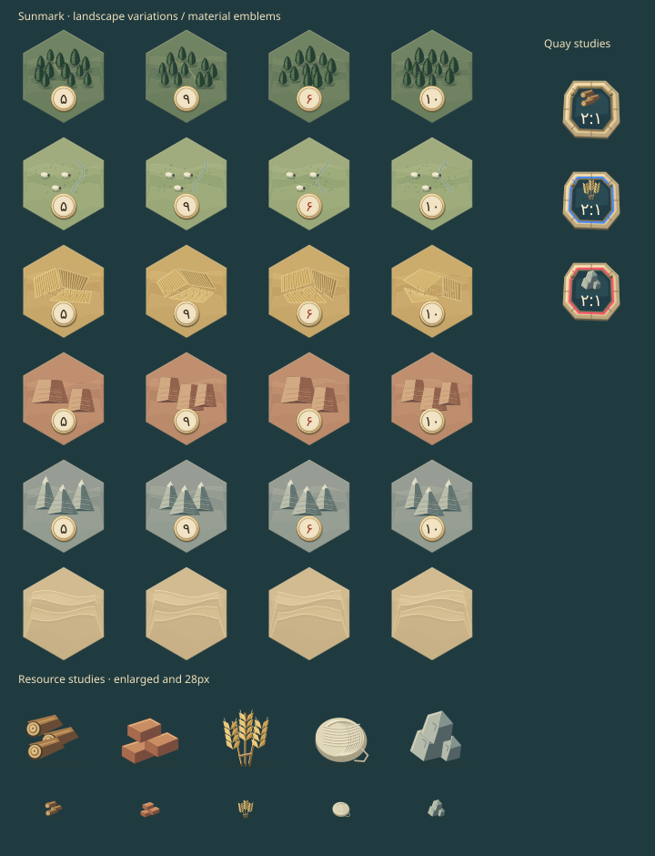

# Procedural board art

The terrain paintings are attractive individually, but their independent lighting, intricate details and high local contrast compete when assembled into a small 19-tile board. The traveler miniature also reads as a separate art style and the illustrated trade scale disappears at dock size. These specific composition/readability issues motivate the user's requested replacement. Original PNG masters remain unchanged under `art/reference/`; the ten retired WebP derivatives are no longer shipped or precached.

## Visual language

All six terrain types share muted mineral colors, upper-left lighting, subdued ground stipple and flowing land contours. Forests contain irregular cypress groves and narrow clearings; wheat uses adjoining plots with individually angled furrows; pastures have rolling meadow bands, irrigation channels, grass and small sheep. Stone peaks have pale caps, fractured faces and scree lines; mesas have broad terraced bluffs and sediment seams; sand has overlapping dune crests and fine wind ripples. Broad washes clip mathematically to the hex boundary, without renderer masks. Strong landscape detail stays above the quiet number area.

Each terrain has four authored compositions. `boardTerrainVariants()` sorts coordinates and assigns unused compositions within each terrain, so every repeated terrain on the normal board differs. Save-array ordering and gameplay redraws do not change the assignment. Art uses a separate deterministic local generator, never the game's random source. No rule/state/save format changes are involved.

`resourceArt.ts` defines five material emblems: cut logs with end grain, beveled fired-clay bricks, grain ears, a wound wool skein and fractured stone. `boardEmblems.ts` generates one shared 640 × 128 transparent atlas with five 128-pixel square frames. Existing hand, trade, cost, flight and harbor Image consumers all use this generated atlas. Semantic placeholders are square. Number tokens are code-drawn turned limestone with a bronze lip and short rim engravings; their 15.4-pixel Persian digits remain separate runtime text. The former resource atlas and medallion had fine relief that collapsed at 14–32 pixels and inconsistent padding/proportions; the user's requested code-drawn replacements address those specific issues. Original PNG masters and reviewed historical crops remain preserved in the manifest's references.

`harborArt.ts` supplies a limestone quay with ashlar joints, a shaded blue basin and small bronze mooring fittings. `ports.ts` adds the planked dock links, shared specialist symbols/general exchange arrows and runtime rate text. Existing offshore spacing, ownership colors and touch targets remain unchanged.

Ahriman (اهریمن) is an original winged shadow-spirit emblem with a pale stone rim and two restrained amber eyes. This is a fictional game depiction, not a claim to reconstruct a canonical ancient image. Its silhouette and contrast remain visible over every terrain. It blocks only the tile's production, moves on seven, and starts on the desert. Destination previews use the same geometry at half opacity; existing movement/reduced-motion behavior is retained. Persian prompts, tutorial, help, phase labels, errors and event notices consistently name Ahriman. Internal `robber` state/command/error and lesson identifiers remain intact for saved-match compatibility.

Trading uses a compact geometric scale with a bronze beam, two pans and a limestone base. The same vector plan paints the 28-pixel dock icon and the 64-pixel bank workspace illustration. Its transparent semantic placeholder reserves layout space without requesting a texture. The icon is decorative; the adjacent Persian label names its action.

Regenerate with `node scripts/export-board-art-study.mjs`. The study uses the actual vector plans, enlarged terrain/quay views and both enlarged and 28-pixel resource views. It is a static composition reference, not a browser screenshot; final font shaping, antialiasing, board assembly and touch behavior require user device review. The earlier `procedural-board-study.svg` remains a historical reference.

## Rendering and budgets

- `rendering/vectorArt.ts` defines portable polygon, line and ellipse plans and a Phaser Graphics painter. It needs no browser APIs, filters or masks to describe art.
- `rendering/terrainArt.ts` authors all terrain plans; `terrainTextures.ts` generates **24 transparent 320 × 320 textures**, using one scratch Graphics object released in `finally`. Generation runs at scene creation and skips already cached keys. No update loop regenerates textures; Phaser owns them until game destruction. Variants derive from axial coordinates, never `Math.random()` or the game's random source.
- `GameScene` keeps terrain sprites in their own layer. Unchanged terrain/layout survives rolls, paid builds, Ahriman moves and placement previews; a different terrain arrangement, resize or new match refreshes that layer. Number tokens, highlights, legal destinations, ports and player pieces remain in the dynamic board layer. Terrain images need no per-tile stencil/geometry masks.
- `rendering/ahriman.ts` paints one Graphics child in a movable container. `rendering/tradeArt.ts` paints into the interface's existing shared Graphics layer. Neither adds timers, particles or texture downloads.

The ten retired WebP files total **5,999,036 bytes**, including **1,425,684 bytes** removed for the number token and resource atlas in this revision. Active packaged bitmap size is **8,201,868 bytes** across 14 WebPs. Terrain texture storage is **9.375 MiB** (24 × 320 × 320 × 4), plus **0.3125 MiB** for the generated resource atlas. These are nominal base pixel budgets, excluding driver overhead, CPU copies and unrelated textures; they are not measured browser performance. Generated textures are reused until game destruction.

## Asset preservation and verification

`scripts/image-exports.json` separates the 14 active `assets` from ten retired `references`. References preserve the original file identity, PNG dimensions, SHA-256 and historical crop metadata. The export command only regenerates active files; its full check also verifies retired masters, so it cannot silently restore unused paintings to `public/`. Existing masters and unrelated runtime artwork are unchanged. `tests/asset-exports.test.ts` validates active packaging and preserved reference checksums.

`tests/procedural-art.test.ts` checks detail bounds/quiet areas, deterministic independent variation, texture-cache limits and reuse, scratch cleanup on failure, vector output at dock size, Ahriman preview opacity, localized naming, production blocking, and saved-state validation. Focused TypeScript/lint/format checks and the Node suite cover integration; production builds, CI and browser/device review remain user-run under `AGENTS.md`.
