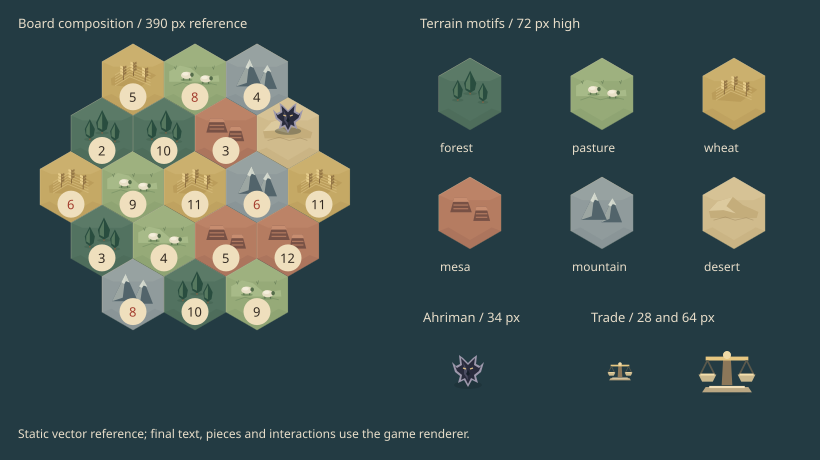

# Procedural board art

The terrain paintings are attractive individually, but their independent lighting, intricate details and high local contrast compete when assembled into a small 19-tile board. The traveler miniature also reads as a separate art style and the illustrated trade scale disappears at dock size. These specific composition/readability issues motivate the user's requested replacement. Original PNG masters remain unchanged under `art/reference/`; the eight retired WebP derivatives are no longer shipped or precached.

## Visual language

All six terrain types share muted earth/mineral colors, upper-left light, broad facets and restrained rims. Terrain-specific silhouettes carry identity as well as color: cypresses for forest, sheep and meadow bands for pasture, crop rows and three grain ears for wheat, horizontally layered bluffs for hills/mesa, angular pale-capped mountains for stone, and dunes for desert. Small deterministic offsets provide two variants per terrain. Motifs occupy the upper portion; the lower number-token area remains quiet. Runtime number text, original number medallions, player pieces, ports, and hit targets remain separate.

Ahriman (اهریمن) is an original winged shadow-spirit emblem with a pale stone rim and two restrained amber eyes. This is a fictional game depiction, not a claim to reconstruct a canonical ancient image. Its silhouette and contrast remain visible over every terrain. It blocks only the tile's production, moves on seven, and starts on the desert. Destination previews use the same geometry at half opacity; existing movement/reduced-motion behavior is retained. Persian prompts, tutorial, help, phase labels, errors and event notices consistently name Ahriman. Internal `robber` state/command/error and lesson identifiers remain intact for saved-match compatibility.

Trading uses a compact geometric scale with a bronze beam, two pans and a limestone base. The same vector plan paints the 28-pixel dock icon and the 64-pixel bank workspace illustration. Its transparent semantic placeholder reserves layout space without requesting a texture. The icon is decorative; the adjacent Persian label names its action.

This reference is exported from the same vector plans at nominal CSS sizes. It illustrates composition, not a browser screenshot: number medallions are simplified and game pieces, ports and interface controls are omitted. Device review remains necessary for final text, antialiasing, motion and touch behavior.

## Rendering and budgets

- `rendering/vectorArt.ts` defines portable polygon, line and ellipse plans and a Phaser Graphics painter. It needs no browser APIs, filters or masks to describe art.
- `rendering/terrainArt.ts` authors all terrain plans; `terrainTextures.ts` generates **12 transparent 320 × 320 textures**, using one scratch Graphics object released in `finally`. Generation runs at scene creation and skips already cached keys. No update loop regenerates textures; Phaser owns them until game destruction. Variants derive from axial coordinates, never `Math.random()` or the game's random source.
- `GameScene` keeps terrain sprites in their own layer. Unchanged terrain/layout survives rolls, paid builds, Ahriman moves and placement previews; a different terrain arrangement, resize or new match refreshes that layer. Number tokens, highlights, legal destinations, ports and player pieces remain in the dynamic board layer. Terrain images need no per-tile stencil/geometry masks.
- `rendering/ahriman.ts` paints one Graphics child in a movable container. `rendering/tradeArt.ts` paints into the interface's existing shared Graphics layer. Neither adds timers, particles or texture downloads.

The eight removed WebP files totaled **4,573,352 bytes**. Total packaged bitmap size decreases from 14,200,904 to **9,627,552 bytes**. Their original 1254 × 1254 RGBA dimensions imply 50,320,512 bytes (about 48 MiB) of base decoded pixel storage; the new terrain cache is **4.69 MiB** (12 × 320 × 320 × 4). These are asset/nominal pixel budgets, not measured browser memory, startup time or frame-rate results; driver overhead, duplicate CPU copies and other game textures are excluded. The highest normal 480-pixel shell at 3× density still fits the generated terrain resolution. Shared images stay crisp without retaining eight full-size painted textures.

## Asset preservation and verification

`scripts/image-exports.json` separates the 16 active `assets` from eight retired `references`. References preserve the original file identity, PNG dimensions, SHA-256 and historical crop metadata. The export command only regenerates active files; its full check also verifies retired masters, so it cannot silently restore unused paintings to `public/`. Existing masters and unrelated runtime artwork are unchanged. `tests/asset-exports.test.ts` validates active packaging and preserved reference checksums.

`tests/procedural-art.test.ts` checks detail bounds/quiet areas, deterministic independent variation, texture-cache limits and reuse, scratch cleanup on failure, vector output at dock size, Ahriman preview opacity, localized naming, production blocking, and saved-state validation. Focused TypeScript/lint/format checks and the Node suite cover integration; production builds, CI and browser/device review remain user-run under `AGENTS.md`.
