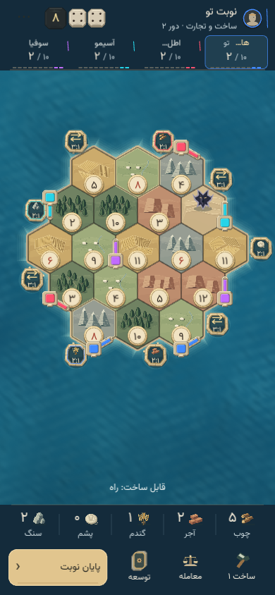
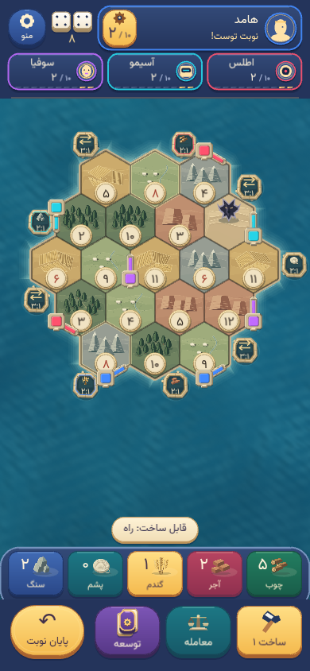
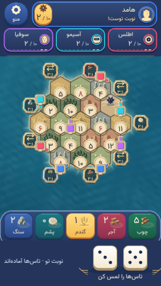
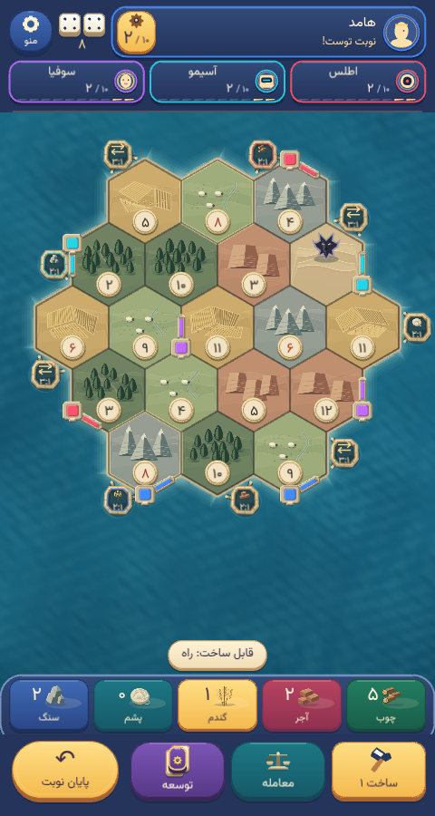
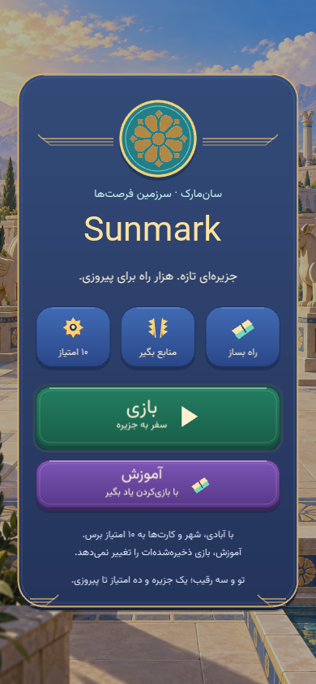
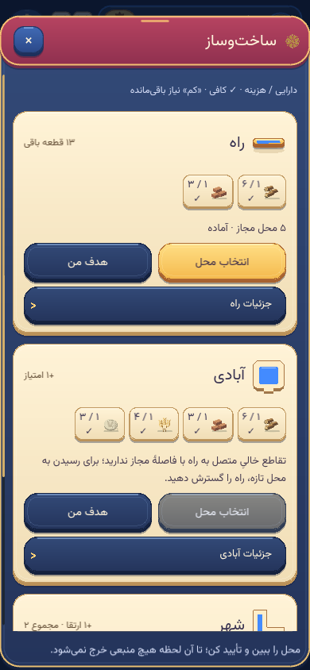
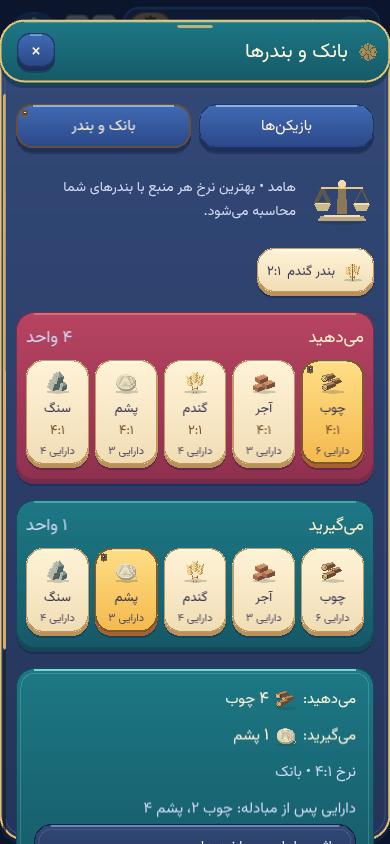
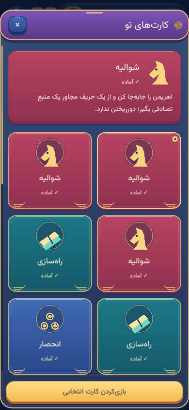
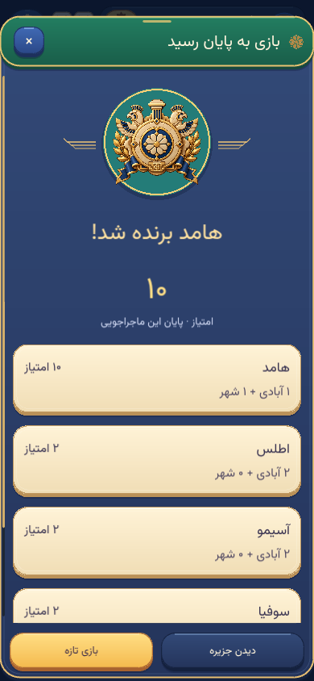
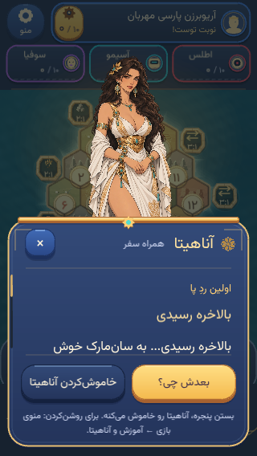

# Royal expedition UI review

This implementation replaces the restrained interface with a colorful, dimensional mobile-game system. The preserved palace, ocean, terrain, pieces, resource illustrations and narrator are joined by enamel action seals, polished gold settings, stepped wing inlays, parchment construction cards and colored development cards. All new artwork is code-drawn; no additional runtime images, fonts or dependencies ship.

## Complete screens

These are unretouched captures of the running application, exported losslessly. The before/after match uses the same deterministic four-player opening, inventory and roll. Fixtures seed valid saved games through the existing development helpers; interactions use the actual semantic controls, session and core commands.

| Previous match, 390 × 844 | Royal expedition, 390 × 844 |
| --- | --- |
|  |  |

| Short-screen dice, 320 × 568 | Wider match, 480 × 900 |
| --- | --- |
|  |  |

| Palace entry | Construction |
| --- | --- |
|  |  |

| Bank exchange | Development hand |
| --- | --- |
|  |  |

| Victory and fixed actions | Narrator, 320 × 568 |
| --- | --- |
|  |  |

## Composition and interaction

- The human captain leads the HUD with a portrait, readable name, personal score/target and acting-player subtitle. Opponents have a separate portrait row. Their public scores and owner-colored settings remain inspectable. Full short opponent names survive fractional font measurements; longer human names can wrap.
- Resources are collected objects on a shared shelf. Construction is amber, trade turquoise, development violet, and the primary decision a larger gold seal. Pressing depresses the enamel face; selected, disabled and keyboard-focus states remain distinct.
- A separate contextual ribbon leaves tiles and coastal ports unobstructed. On measured boards below 420 pixels high, direct dice move to the lower action ledge, recovering the ocean band for the island. Other boards retain standalone dice offshore. Rolling and placement use the same board projection.
- Bottom sheets share lapis-and-gold frames, with coral construction, turquoise exchange and amethyst card headers. Give/receive sections and card kinds carry distinct colors. Costs, missing resources, selected destinations and confirmations remain core-derived. Results keep final-board and new-game actions fixed outside the scroll area.
- Actual dice values pop and travel to the HUD; confirmed resources, cards, points and construction retain bounded feedback. A short sunburst now marks the human turn. Motion respects visibility, quick feedback and reduced-motion preferences. Animation never issues commands or gates the action phase.

The supplied references informed depth, color harmony and recognizable game-object silhouettes. Their artwork and layouts are not included. Achaemenid character comes from the preserved world art, sun rosettes, stepped wings, gold craftsmanship and architectural piece plans.

## Validation

- All 283 tests in 32 files pass; updated header/privacy, coastal-clearance and feedback checks retain meaningful assertions.
- Type-checked production build, ESLint, Prettier and PWA artifact checks pass. Vite retains its Phaser bundle-size advisory.
- Chromium checks at 320 × 568, 390 × 844 and 480 × 900 cover direct rolling, real board road taps, list selection and paid confirmation, bank trading with automatic close, repeated card purchases, public player details and long card-hand scrolling. Main controls retain at least 48-pixel height with no horizontal overflow.
- Additional states cover setup, waiting for a bot, the human discarding during a bot turn, Knight/Ahriman movement, free roads, a ten-point victory declaration and return from results to the final board. Safe-area simulation uses 47-pixel top and 34-pixel bottom insets.
- Keyboard menu activation, native modal focus restoration, long Persian names, live resize, animated and reduced-motion rolling were exercised without browser errors.
- The built production preview at 2× density restored a save, rolled actual 4/4, selected and paid for a road, and retained the public dice without browser errors.

These are desktop Chromium checks using mobile viewports and software WebGL. Physical-device touch, GPU performance and installed iOS/Android behavior remain device-review work. No CI run was requested or monitored.
